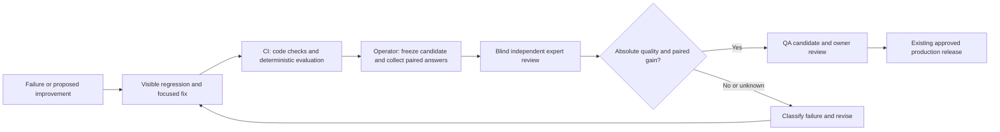

# Research Assistant expertise CI/CD

> Working-plan consolidation (2026-11-03): Current priorities, open acceptance gates and the disposition of this historical document are tracked in [deck-inference-v1.json](deck-inference-v1.json). Retain this document as historical evidence/technical reference; do not start a parallel backlog here. Historical implementation or QA claims below are not fresh deployment or quality validation.

## Decision

Use two independent release signals: ordinary software regression checks and a
blinded, held-out MTG expertise comparison. A green unit-test suite is never a
claim of broad MTG expertise. Optimize the knowledge system—corpus, retrieval,
mechanical relationships, query plans and evidence presentation—without changing
model weights.

This increment implements the offline comparison gate, blinded packet creation,
strict input schemas, policy and regression-report CI wiring. It defines a
manual GitHub qualification workflow. It does **not** enroll fictitious experts,
claim a sealed benchmark already exists, start paid evaluation jobs, configure
GitHub environment protections, publish a workflow, or enable automatic releases.

The complete operational loop is:



## Stage 1: free continuous regression checks

Every PR/main CI runs the existing tests and
`scripts/evaluate_assistant_intelligence.py`, retaining its JSON measurements as
an `assistant-regression-*` artifact. The current 26 visible cases cover memory,
retrieval and requirement predicates. They are development regression evidence,
not the sealed test or a score for general deck-building expertise.

The new gate's synthetic control tests deliberately fabricate test reviewers to
exercise failure behavior. They never enter a real expertise report or the
approved reviewer registry. Tests check missing evidence, duplicate reviewers,
self-review, critical errors, weak domains, packet tampering and false gains.

## Stage 2: controlled answer collection

A benchmark custodian independently authors the frozen challenge set, sources and
rubric. Start with a 24-case calibration pilot, which cannot qualify broad
expertise. The initial qualification target is 120 distinct questions, at least
12 commanders and 6 archetypes, with at least 12 cases in each domain:

| Domain | What the expert must distinguish |
| --- | --- |
| Rules | Casting versus playing/copying; timing, targets, costs, replacement effects |
| Mana and sequencing | Colored requirements, resource prerequisites, alternative costs, realistic opening lines |
| Synergy and combos | Ingredients versus legal execution; zones/setup, interruption, commander dependence |
| Deck construction | Role preservation, curve, interaction, redundancy, recovery and meaningful swap tradeoffs |
| Metagame and statistics | Commander/partner cohorts, denominators, windows, popularity versus enrichment versus causality |
| Uncertainty and constraints | Unsupported mechanics, sparse data, conflicting evidence, theme/power limits and appropriate abstention |

Include combo, stax, spell-engine, creature/toolbox, graveyard and land/mana
strategies; vary color identities, speed and commander dependence. Include both
answerable and intentionally unanswerable questions, multi-turn corrections,
ambiguous requests, misleading premises and source-injection attempts. At least
one quarter should concern commanders absent from visible development examples.
A custodian must verify that these labels describe real cases; changing string
labels cannot establish coverage. The code enforces count/coverage floors and
rejects exact duplicate question/context pairs, not semantic duplication.

The capture operator must execute the actual incumbent and candidate on identical
question/deck contexts in fresh disposable sessions, using public/consented deck
fixtures and a frozen corpus per system. Do not copy production private accounts,
decks or conversations. Record complete answers, citations, exact code revisions,
model/provider identities, prompt/settings hashes, corpus hashes and measured
costs. Code, corpus or prompt changes are all candidate changes.

Use the full independent qualification at deliberate release milestones. Routine
commits run the free regression lane. The first calibration pilot should expose
rubric ambiguities before commissioning the larger qualification. As experts
ratify concrete failures, move their executable expectations into ordinary CI;
that grows automatic coverage without requiring a new human review for every
commit. A later calibrated-judge policy can reduce review volume, but it needs
its own validated operating thresholds and owner-approved policy revision.

Use Suggest mode on disposable databases, no adoption or production writes. Keep
one local embedding process/thread and one heavy evaluation job at a time. Route
provider calls through the existing cost ledger and global ceiling; reserve a
per-run spend budget before collection, then stop on exhaustion. The grader's
$5 default checks *reported* run cost; it cannot enforce provider spending or
prove that supplied answers were actually captured. A trusted collector/export
adapter is the next integration, not implemented here. Cached incumbent answers
are reusable only when benchmark, context, model/config and corpus identities
match, with their original provenance retained.

## Stage 3: blind review with an explicit trust root

The CLI emits a reviewer packet and a separate private key. Each case randomly
assigns the candidate to A or B, balanced across the packet. Reviewer packets
contain the question, context, reference excerpts, both answers and citations;
they omit system/revision/contributor identities and the candidate mapping.
Blinding reduces presentation bias; distinctive answer style can still reveal a
system. Counterbalanced duplicate audit packets are a later calibration extension.

Two enrolled MTG experts review every case independently without seeing the
mapping or each other's votes. Enroll stable person IDs and domain qualifications
in the protected policy. Aliases for the same person cannot provide two votes.
System contributors and question authors cannot review their own work. The
benchmark curator cannot be a contributor to either compared system. The policy
must also explicitly enroll the frozen benchmark digest.

Each expert scores **both** A and B on five dimensions, 0–4:

| Dimension | A score of 3 requires |
| --- | --- |
| Correctness | The material rules, resource and statistical claims are correct |
| Grounding | Claims are supported by the supplied appropriate sources; missing evidence stays missing |
| Strategic fit | The advice serves this deck and objective rather than generic popularity |
| Tradeoffs | The answer accounts for meaningful setup, lost functions and relevant alternatives |
| Uncertainty | The answer's certainty matches what the evidence and execution coverage establish |

Score anchors: 0 = materially wrong, 1 = major omissions/errors, 2 = partly useful
but materially incomplete, 3 = useful and supported, 4 = unusually thorough and
precise without unnecessary prose. Length itself is not quality. An abstention
can score 4 when evidence is missing and score 0 when the supplied facts settle
the question. Identify critical failures separately: invented cards/Oracle text,
illegal or impossible lines, fabricated evidence, unsupported measured win or
upgrade claims, and bypassed user constraints. A small stylistic flaw is not a
critical error. Provide an evidence-based rationale and prefer A, B or tie.

Review identities in JSON are **not authentication**. The trusted operator must
collect and attest the real enrolled people's reviews. Hashes bind the reviewed
content and key; they do not prove who authored it, expertise, actual system
execution, or that the developer never saw the holdout. Reviewer enrollment,
protected-main policy review and custody are organizational requirements. This
implementation does not add review signatures or an authenticated expert portal.

Model judges—including Jev and a separately pinned reasoning model—can check
source support, suggest counterexamples and prioritize human attention. Batch
narrow relevance/citation questions over compact public evidence. Never send
credentials or private user data. Their votes remain advisory and cannot satisfy
the expert quorum, even when their model differs from the answering model. Jev
was not configured in this session; no API calls or runtime dependency were added.
Future delegation should require calibration against independent human labels
per domain, monitor disagreements and keep novel/critical cases with experts.

This distinction matters because LLM judges can exhibit position, verbosity and
self-enhancement bias; the [MT-Bench judge paper](https://arxiv.org/abs/2306.05685)
examines these limitations. The [TypeSafe citation-check cookbook](https://docs.typesafe.ai/cookbooks/citation_check)
illustrates the useful narrow pattern: exact quote checks in code, followed by
semantic support assessment. Neither source establishes MTG expertise.

## Stage 4: executable qualification policy

Initial thresholds are explicit operating targets, not empirically calibrated
universal cutoffs. Change them through reviewed policy changes, never in a
candidate's downloaded evidence archive.

* Require the complete frozen case set. Missing or unavailable cases cannot be
  omitted to improve a denominator.
* Require enrolled curator/benchmark and two independent, domain-enrolled experts
  per case. Model-only reviews, unapproved reviewers, author overlap, stale runs,
  expired benchmarks and conflicting candidate/baseline preferences block review.
* An exact cited quote must occur in its named reference. This catches fabricated
  quotes; it cannot establish that a real quote semantically supports a claim.
* Require every candidate rubric dimension ≥3 for a passing case, ≥90% passing
  cases overall and ≥80% in every domain. No critical candidate error is allowed.
* At most 5% of cases may prefer the incumbent. Opposing expert votes need
  adjudication and a new attested review set; do not average the conflict away.
* Count a candidate win only when all counted experts prefer it; candidate/tie
  disagreement is a tie. Count incumbent/tie conservatively as incumbent.
* For improvement, first collapse paired preferences to one win/loss/tie per
  commander. Require at least eight decisive commander groups and a 95% Wilson
  lower bound on the candidate's group-win share above 0.5. One commander with
  many paraphrases cannot provide dozens of independent wins. This grouped
  operating rule is not proof of independent samples, causality, multiplayer win
  rate or generalization beyond the reviewed benchmark. Future larger studies
  should model archetype/source dependence and pre-register repeated testing.
* Freeze evidence before review, pin reports to the exact candidate commit, and
  bind benchmark, answers, blinding key and policy with canonical JSON hashes.
  Reports expire after 14 days; benchmark enrollment requires freshness review
  within 90 days and immediately after material rules/bans/source changes.

Outputs distinguish `blocked`, `failed`, `qualified_no_gain` and
`qualified_improvement`. Only the last is promotion-*eligible*. A passing
absolute-quality score with ties is not evidence the candidate improves on the
incumbent. Metrics in a blocked report are provisional, not qualification scores.
No output authorizes deployment.

## Stage 5: deployment and the improvement loop

The new manual GitHub workflow consumes an `assistant-expertise-input` artifact
from a successful, owner-initiated workflow run for the exact candidate in the
same repository. It executes the validator and enrollment policy from trusted
main, checks source-run provenance, and uploads only the resulting report. It
has no model secrets or deployment job. Configure the `assistant-expertise`
environment's required reviewers and `RELEASE_OWNER` before using it. Producing
the input artifact through the future trusted capture/review exporter remains an
operator integration; this change does not fabricate such a producer workflow.

For assistant reasoning/retrieval/corpus changes, the intended release executor
must verify a fresh `qualified_improvement` report matching the reviewed code,
model/config and corpus identities. Then prepare a QA image, smoke it, test real
tool receipts and preserve deck ownership/revisions. The owner reviews QA; only
explicit approval permits the existing verified DigitalOcean production release.
UI-only changes use normal regressions and QA without pretending they improve
MTG expertise. The legacy Fly deployment workflow is historical and must not be
reactivated for this design. Wiring the expertise receipt into the infrastructure
release executor is separate work; today's deployment scripts do not enforce it.

Every failed or disputed case produces a triage item using its actual receipts:

| Failure source | Improvement to test |
| --- | --- |
| Missing/stale source | Expand or refresh an attributable corpus; expose its coverage |
| Relevant evidence not retrieved | Repair query decomposition, tags, embeddings or rank fusion |
| Wrong mechanic/resource relationship | Add a scoped predicate/prerequisite and a counterexample |
| Correct receipts, wrong conclusion | Tighten typed outcomes or evidence presentation; add a narration case |
| Bad swap despite correct facts | Fix objective/role-preservation comparisons and strategic review |
| Insufficient execution coverage | Expand the independently checked simulator model; suppress unsupported metrics |

Do not feed the assistant's own prose back as authoritative MTG knowledge. An
accepted fix creates a visible development regression with evidence. After
feedback has been exposed to implementers, retire those questions from the sealed
qualification set and remove its enrolled digest; have the custodian seal a new
set before the next improvement trial. Maintain a protected attempt ledger and
pre-register candidate comparisons to avoid tuning repeatedly on one holdout.
The grader itself is stateless and cannot enforce custody or an attempt ledger.
Changing facts/models/corpora invalidates old qualifications; code-only rollback
cannot restore an independently changed corpus. Retain a compatible knowledge
snapshot with each reviewed release.

## Operator commands

Commands run locally over supplied files; none calls a provider, contacts the
live app, or deploys. Keep private benchmark/run/key/review files out of Git.

```bash
PYTHONPATH=src .venv/bin/python scripts/evaluate_assistant_expertise.py schema \
  --output /private/eval/schemas.json

PYTHONPATH=src .venv/bin/python scripts/evaluate_assistant_expertise.py packet \
  --benchmark /private/eval/benchmark.json --run /private/eval/run.json \
  --packet /private/reviewers/packet.json --key /private/coordinator/key.json

PYTHONPATH=src .venv/bin/python scripts/evaluate_assistant_expertise.py gate \
  --benchmark /private/eval/benchmark.json --run /private/eval/run.json \
  --key /private/coordinator/key.json --reviews /private/eval/reviews.json \
  --expected-candidate FULL_40_CHARACTER_SHA \
  --report /private/eval/report.json
```

Use real private paths rather than the illustrative `/private/eval` paths above.
`schema` exports JSON schemas for benchmark, run, review, private key and policy.
`packet` balances and randomizes A/B assignment and refuses to overwrite its key;
the key is created with mode 0600. Share only the packet with reviewers, never
the run file or key. `gate` returns 0 for qualified improvement, 2 for missing or
unratified independent evidence, and 1 for failure/no demonstrated gain/invalid
input. The checked-in registries are empty, so real qualification is currently
blocked by design. Do not add synthetic control reviewers to make it turn green.
